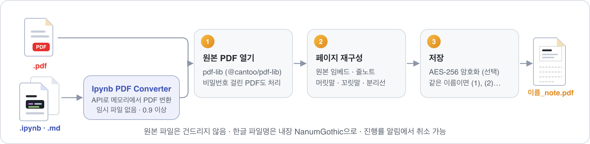
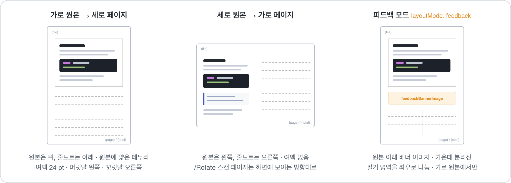

# PDF2Note

**PDF 페이지마다 줄노트 필기 영역과 머릿글을 붙여 새 PDF를 만듭니다.**

`.ipynb` · `.md`도 바로 됩니다. Ipynb PDF Converter가 메모리에서 먼저 PDF로 바꿔 줍니다.

🌐 **소개 페이지 · [pdf2note.hossam.kr](https://pdf2note.hossam.kr/)**

 

> 아이티윌 이광호 강사의 수업용으로 만들었습니다. `pdf2note.py`를 VS Code 확장으로 옮긴 것입니다.

## 한눈에 보기

| | |
|:--|:--|
| 🖱️ **우클릭 한 번** | 탐색기 · 에디터 탭 · 편집기 본문 · 노트북 셀 · 명령 팔레트에서 `.pdf` · `.ipynb` · `.md`에 실행 |
| 📝 **레이아웃 자동** | 가로 원본은 아래에, 세로 원본은 오른쪽에 줄노트. 줄 간격 · 머릿글 크기 · 여백은 페이지 크기에 비례 |
| 💬 **피드백 모드** | 원본 아래 배너 이미지, 필기 영역을 좌우로 나누는 분리선 |
| 📐 **용지** | 원본 크기 유지(기본) 또는 A0-A6 · B0-B6 · Letter · Legal · Tabloid · Ledger · 태블릿 7종(iPad · Galaxy Tab) |
| 🔤 **한글 파일명** | NanumGothic 내장으로 머릿말 · 꼬릿말에 한글 그대로 |
| 🔒 **비밀번호** | AES-256 암호화와 열람 권한. 비밀번호 걸린 원본 PDF도 한 번 물어보고 처리 |
| 🧘 **원본 보존** | 임시 파일 없음, 덮어쓰기 없음(`이름 (1).pdf`), 진행률 알림에서 취소 가능 |
| 🌐 **한국어 UI** | VS Code 표시 언어가 한국어면 한글, 그 외에는 영어 |

## 설치 · 요구 사항

- VS Code 1.84 이상
- `.ipynb` · `.md` 입력에는 **Ipynb PDF Converter 0.9 이상**(`convertToPdfBytes` API 포함)이 필요합니다. 의존 확장으로 선언돼 있어 VS Code가 함께 설치하지만, 버전은 직접 확인하세요. PDF 입력은 단독으로 동작합니다.

## 사용 방법

1. `.pdf` · `.ipynb` · `.md` 파일을 **우클릭**합니다.
2. 명령을 고릅니다.

   | 한국어 UI | English UI | 하는 일 |
   |:--|:--|:--|
   | 필기 영역 추가 (PDF) | Add Note Area (PDF) | 비밀번호 없이 |
   | 필기 영역 추가 (PDF, 비밀번호) | Add Note Area (PDF, with Password) | 설정의 기본 비밀번호로 암호화. 비어 있으면 팝업으로 입력 |
   | 필기 영역 추가 (hossam) · (jussam) | Add Note Area (hossam) · (jussam) | `teacherMode`를 켜면 추가. 강사 마크를 넣음(비밀번호 유무 각각) |

3. 같은 폴더에 `원본이름_note.pdf`가 생깁니다. 같은 이름이 있으면 `이름 (1).pdf`처럼 번호를 붙입니다.

## 설정

설정 이름 앞에는 모두 `pdf2note.`가 붙습니다.

| 설정 | 기본값 | 설명 |
|:--|:--|:--|
| `paperSize` | `original` | 원본 100% 크기로 페이지를 키움. 용지 이름(`A0`-`A6` · `B0`-`B6` · `LETTER` · `LEGAL` · `TABLOID` · `LEDGER` · `iPadPro13` · `iPadPro11` · `iPadAir13` · `iPad11` · `iPadMini` · `GalaxyTabS11` · `GalaxyTabS11Ultra`)을 고르면 원본을 그 안에 맞춰 줄이며 판형은 자동(가로 원본 → 세로 용지, 세로 원본 → 가로 용지) |
| `layoutMode` | `note` | `feedback`: 배너 + 분리선(가로 원본에서만) |
| `feedbackBannerImage` | 비움 | 피드백 배너 이미지(원본 기준 상대 경로 · 절대 경로 · URL). 비우면 분리선만 |
| `lineGap` | `18` | 줄 간격(A4 세로 기준 pt, 6-60). 페이지 크기에 비례해 조절됨 |
| `headerText` · `footerText` | `{file}` · `{page} / {total}` | `{file}` `{date}` `{page}` `{total}` 사용 가능. 비우면 해당 띠를 만들지 않음 |
| `headerAlign` · `footerAlign` | `left` · `right` | `left` · `center` · `right` |
| `headerFooterFontSize` | `10` | 글자 크기(pt, 6-24) |
| `outputDirectory` | 비움 | 비우면 원본 옆. 상대 경로는 원본 폴더 기준, 절대 경로 가능 |
| `outputFileName` | `{name}_note` | `{name}` 원본 이름 |
| `openAfterConvert` | `false` | 변환 후 시스템 뷰어로 열기 |
| `pdfPassword` | 비움 | 비우면 실행 때마다 팝업. `settings.json`에 평문으로 저장됨 |
| `pdfPermissions` | `["annot-forms"]` | 열람자에게 허용할 작업 `print` · `copy` · `modify` · `annot-forms` |
| `ownerPassword` | 비움 | 비우면 PDF 비밀번호(`pdfPassword` 또는 팝업 입력값)와 같음. 이때는 그 비밀번호를 아는 사람에게 `pdfPermissions` 제한이 적용되지 않음 |
| `teacherMode` | `false` | hossam/jussam 명령 추가. Ipynb PDF Converter와 같은 규칙 |

## 라이선스

[MIT](LICENSE). 내장 글꼴 NanumGothic은 SIL Open Font License 1.1 (`media/fonts/NanumGothic-OFL.md`).
